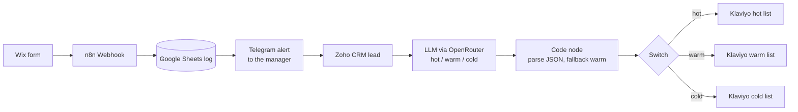

# AI Lead Funnel

A website form lead lands in Google Sheets, Telegram and Zoho CRM, then an AI labels it hot, warm or cold and sorts it into the right Klaviyo email list. All within seconds and with no manual work.

> **Demo case.** This is a demo project for **Karline**, a fictional cake shop with delivery. It was built as a course project (GoIT AI Automator). No real customers or leads are included in this repo.

**Result:** under 10 seconds from form to sorted lead, 15/15 correct AI labels on the test set.

[Demo video](https://youtu.be/Xc4iqySwVNg)

## How it works

1. **Webhook** — the Wix form sends each submission to n8n with a POST request.
2. **Google Sheets** — the lead (date, name, phone, email, comment) is added as a new row, so every lead is logged first.
3. **Telegram** — the manager gets an instant alert with the lead's details.
4. **Zoho CRM** — a lead is created, with the comment in the description.
5. **AI labeling** — an LLM (via OpenRouter) reads the comment and labels the lead `hot`, `warm` or `cold`.
6. **Code node** — parses the JSON answer. If the answer is broken or the label is not one of the three, it falls back to `warm`.
7. **Switch** — routes the lead by label.
8. **Klaviyo** — creates the profile and adds it to the hot, warm or cold list.

## Why "warm" as fallback

When the AI answer cannot be read, the lead has to go somewhere. `warm` is the safest choice:
- A real buyer still gets emails instead of being lost in `cold`.
- Nobody wastes a call on spam that was wrongly marked `hot`.

## Results

| | |
|---|---|
| Speed | under 10 s from form to sorted lead |
| AI accuracy | 15/15 correct labels on a test set of 15 comments (Ukrainian and English, 5 per category) |
| Manual work removed | ~7 min per lead (estimate) |
| Lost leads | 0 on a broken AI answer (fallback to `warm`) |

## Stack
n8n Cloud · OpenRouter LLM (free `nvidia/nemotron-3.5-super-vl` model) · Wix Forms · Google Sheets · Telegram Bot · Zoho CRM · Klaviyo API

## Setup
1. Import `workflow/lead-form-handler.json` into n8n.
2. Connect your credentials: Google Sheets, Telegram Bot, Zoho CRM, OpenRouter, and a Klaviyo API key (Header Auth, `Authorization: Klaviyo-API-Key YOUR_KEY`).
3. Replace the placeholders: `YOUR_TELEGRAM_CHAT_ID`, `YOUR_HOT_LIST_ID`, `YOUR_WARM_LIST_ID`, `YOUR_COLD_LIST_ID`, and pick your own Google Sheet and tab in the Google Sheets node (`YOUR_GOOGLE_SHEET_ID`, `YOUR_SHEET_GID`). The sheet needs the columns `Дата/час`, `Ім'я`, `Телефон`, `Пошта`, `Коментар`.
4. Publish the workflow. In Wix, create an automation on form submit that sends a POST to the webhook **Production URL**. Check that the comment field key in the expressions (`field:form_field_039f`) matches your form.

## Links
- [Demo video](https://youtu.be/Xc4iqySwVNg)
- [Portfolio](https://sustaining-grain-2ce.notion.site/Portfolio-3c61a7c286c881c7b3f0e59620343c67)

---
Built by Anastasiia Ukrainska · [Portfolio](https://sustaining-grain-2ce.notion.site/Portfolio-3c61a7c286c881c7b3f0e59620343c67)
